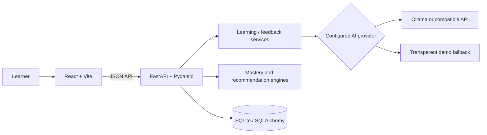

# LearnForge — Understand. Connect. Apply.

**ForgeHacks · AI + Education**

LearnForge turns a topic into an interactive learning cycle: understand the idea, connect it to related concepts, apply it to a realistic challenge, and think more deeply about it. It is an AI-powered learning system—not a general chat window—with progressive hints, reasoning-focused feedback, a learner dashboard, and transparent progress tracking.

## The problem

Students often memorize definitions without seeing how ideas relate or how to use knowledge in realistic situations.

## The solution

A learner chooses a topic and level. LearnForge creates a structured path with a simple explanation, analogy, example, common mistakes, interactive concept map, spoiler-free application challenge with progressive hints, and a reflective question. Progress is persisted and weighted into a mastery score.

## Features

- **Understand:** level-aware explanations, analogies, examples/code, key takeaways, and common mistakes.
- **Connect:** clickable concept map with meaningful relation and practical-use descriptions.
- **Apply:** realistic challenges, progressive hints, answer submission, and constructive evaluation without automatically revealing a solution.
- **Think:** open-ended questions evaluated for reasoning rather than exact wording.
- **Progress:** persisted sessions, weighted mastery (25/20/35/20), streak, challenge accuracy, activity, skill breakdown, and achievements.
- **Adapt:** learner level in generation, challenge performance, and personalized recommendations.
- **Demo-ready:** seeded Demo Learner and five sample topics; deterministic offline fallback is visibly labeled.
- **AI provider abstraction:** Ollama and OpenAI-compatible chat-completions APIs configured server-side through environment variables.
- Responsive dashboard and learning studio, animated transitions, loading/error states, keyboard-friendly controls, and reduced-motion support.

## Architecture



See [docs/architecture.md](docs/architecture.md) for details.

## Tech stack

- Frontend: React, Vite, Framer Motion, Lucide, Recharts, custom responsive CSS.
- Backend: Python 3.10+, FastAPI, Pydantic Settings, SQLAlchemy 2, SQLite, httpx.
- Tests: pytest and FastAPI TestClient.

## Run on Windows (no Docker)

Docker is **not required** to develop or run LearnForge. The backend, frontend, and database run directly on Windows; SQLite stores data in `backend/learnforge.db`. The default `AI_PROVIDER=demo` mode provides the complete learning experience without an API key, paid service, LLM server, or internet connection.

Prerequisites: Python 3.10+ and Node.js 20+ (npm is included with Node.js).

### One-time setup

Open two PowerShell terminals in VS Code, starting from the project root.

In the backend terminal:

```powershell
cd backend
python -m venv venv
.\venv\Scripts\Activate.ps1
pip install -r requirements.txt
if (!(Test-Path .env)) { Copy-Item .env.example .env }
```

In the frontend terminal:

```powershell
cd frontend
npm install
if (!(Test-Path .env)) { Copy-Item .env.example .env }
```

The `.env.example` files contain local defaults. Both environment files are optional; these copy commands are only needed if you want to customize settings. Do not overwrite an existing `.env` file if it contains settings you want to keep.

### Start LearnForge

In the backend terminal, from the `backend` directory with its virtual environment activated:

```powershell
uvicorn app.main:app --reload
```

In the frontend terminal, from the `frontend` directory:

```powershell
npm run dev
```

Open http://localhost:5173. Interactive API docs are at http://localhost:8000/docs. Keep both terminals open while using the app.

If PowerShell blocks virtual-environment activation, allow activation for this terminal only and retry:

```powershell
Set-ExecutionPolicy -Scope Process -ExecutionPolicy Bypass
.\venv\Scripts\Activate.ps1
```

### Optional local AI provider

AI is optional. To use Ollama, install and run Ollama separately on Windows, pull a compatible model, and set these values in `backend/.env`:

```dotenv
AI_PROVIDER=ollama
AI_BASE_URL=http://localhost:11434/v1
AI_API_KEY=
AI_MODEL=qwen2.5:1.5b
```

If Ollama is not running or configured, LearnForge uses its clearly labeled demo content and evaluation. No paid cloud API is needed. The frontend's optional API override is `VITE_API_URL=http://localhost:8000`.

### Optional Docker deployment

Docker files are retained only for users who choose container-based deployment. Local Windows development and the commands above do not invoke Docker, Docker Compose, container networking, or container-specific settings.

## API overview

| Method | Endpoint | Purpose |
|---|---|---|
| GET | `/` | API identity |
| GET | `/api/health` | Service and provider mode |
| POST | `/api/teach` | Backward-compatible learning generation |
| POST | `/api/topic/generate` | Generate structured lesson and create session |
| GET | `/api/topics` | List known topic catalog |
| GET | `/api/progress` | Dashboard progress and recent activity |
| POST | `/api/progress` | Update a mastery dimension |
| POST | `/api/challenge/evaluate` | Evaluate learner's challenge attempt |
| POST | `/api/challenge/hint` | Reveal one progressive hint |
| POST | `/api/think/evaluate` | Evaluate reasoning response |
| GET | `/api/recommendations` | Suggest next topics |
| GET | `/api/sessions/{id}` | Inspect session mastery |

## Tests

```powershell
cd backend
pip install -r requirements.txt
pytest -q
```

Build frontend:

```powershell
cd frontend
npm install
npm run build
```

## Screenshots

Capture the landing page, dashboard, and the Python Loops learning journey here after running the app. No reference images were available in the project workspace during implementation.

## Database

SQLite initializes automatically on backend startup. Models include users, topics, learning_sessions, progress, challenges, challenge_attempts, and achievements. Change `DATABASE_URL` for another SQLAlchemy-supported database such as PostgreSQL.

## Future improvements

- Add authenticated multi-user profiles and learner privacy controls.
- Persist per-topic skill calibration and schedule spaced review.
- Use provider-native structured output / JSON schema where available and add richer, topic-specific fallback packs.
- Add stronger static/sandboxed code execution for coding challenges; current demo evaluator provides lightweight formative feedback and must not be treated as a secure code judge.
- Add frontend component and browser-based end-to-end tests, deployment telemetry, and accessibility audits.

## Hackathon pitch

**LearnForge makes learning active:** AI tutoring + concept relationships + real-world application + adaptive feedback + visible progress. One topic becomes an understanding journey.
