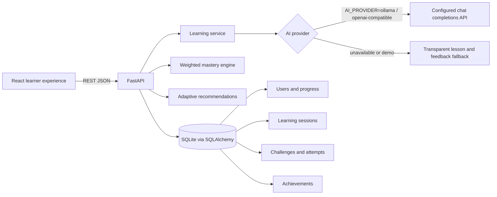

# LearnForge architecture

## Boundaries

- `frontend/src/services/api.js` isolates transport configuration from React UI.
- `backend/app/main.py` owns HTTP routes, input validation, persistence, and dependency injection.
- `backend/app/services.py` owns provider communication, response parsing, educational fallback content, and answer evaluation.
- `backend/app/models.py` uses SQLAlchemy portable models; SQLite is the local default and can be replaced through `DATABASE_URL`.
- AI calls use an OpenAI-compatible `/chat/completions` endpoint. Ollama's OpenAI-compatible API works with a local base URL; compatible cloud endpoints use a secret API key supplied only to the backend.
- Mastery uses Understanding 25%, Connections 20%, Application 35%, and Thinking 20%. Values are clamped to 0–100 and dimension scores are retained per session.

## Demo reliability

The `demo` provider is deterministic and makes no network calls. Configured provider failures or invalid JSON safely fall back to clearly marked demo lessons and demo feedback. The UI labels response sources, so fallback output is never represented as generated AI.
